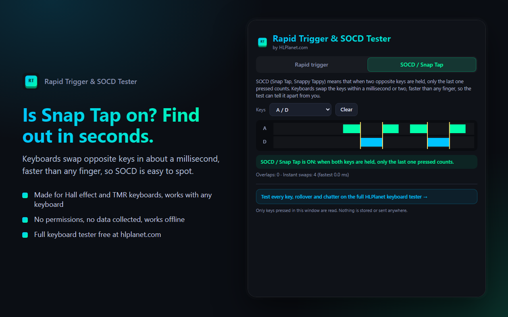
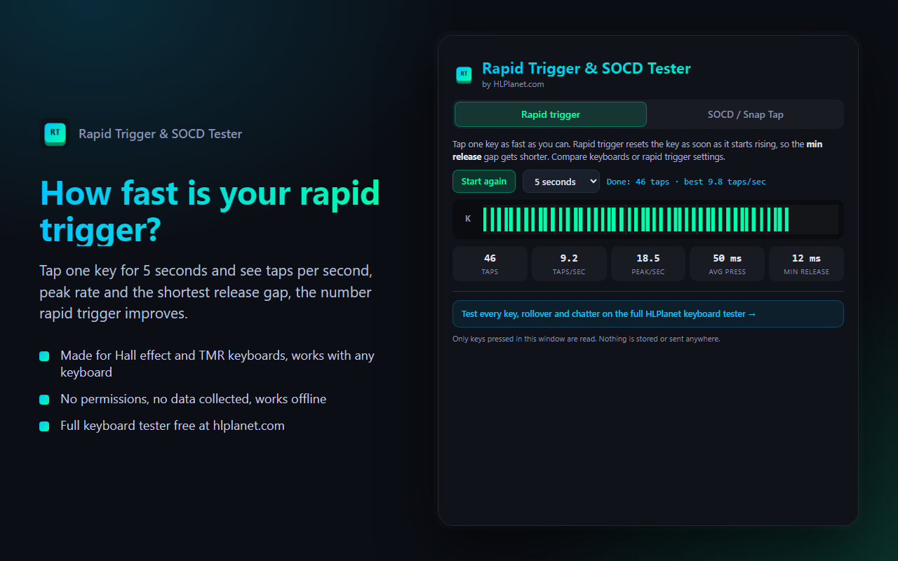

  

<h1 align="center">Rapid Trigger &amp; SOCD Tester</h1>

  Test rapid trigger tap speed and SOCD / Snap Tap on Hall effect and TMR keyboards. 
  Free and open source (MIT), no permissions, no data collected. 
  <b><a href="https://www.hlplanet.com/online-keyboard-tester-tool/">Try the full keyboard tester online at HLPlanet.com</a></b>

## What it tests

**Rapid trigger tap test**: tap one key as fast as you can for 5 or 10 seconds. You get taps per second, peak tap rate,
average press length and the shortest release gap. Rapid trigger resets a key as soon as it starts rising, so the release
gap is where it shows. Compare keyboards or your own rapid trigger settings.

**SOCD / Snap Tap test**: SOCD (Snap Tap, Snappy Tappy, Rappy Snappy) makes the last of two opposite keys win when both
are held. Keyboards swap the keys within a millisecond or two, faster than any finger, so the tester can tell whether SOCD
is on or off. Works with A/D, W/S or the arrow keys, with a live timeline of both keys.

## Download

| Platform | Get it |
|---|---|
| Windows app | [Latest release](https://github.com/hlplanet/rt-socd-tester/releases/latest) (portable, ~300 KB), or `winget install HLPlanet.RTSOCDTester` |
| Chrome, Edge, Brave, Opera | Browser extension (store links coming soon) |
| Firefox | Browser extension (store link coming soon) |
| Any browser | [Online keyboard tester on HLPlanet.com](https://www.hlplanet.com/online-keyboard-tester-tool/) with rollover, chatter and both tests above |

The Windows app needs the Microsoft Edge WebView2 Runtime, which is built into Windows 11.
The exe isn't code-signed yet, so Windows SmartScreen may ask you to click "More info > Run anyway" the first time.

## Privacy

The tester only reads keys pressed inside its own window. It never sees what you type in other apps or websites,
makes no network requests and stores nothing except your best tap score, locally. See [PRIVACY.md](rt-socd-extension/PRIVACY.md).

## Project layout

- `rt-socd-extension/`: the tester (HTML/CSS/JS) and the browser extension (Manifest V3, one package for Chromium and Firefox)
- `rt-socd-windows/`: the Windows app, a small WinForms window hosting the same tester with WebView2
- `docs/`: screenshots

Build the extension zips with `rt-socd-extension\build.ps1` and the Windows app with `rt-socd-windows\build.ps1`
(no SDKs needed, the C# compiler ships with Windows).

## License

[MIT](LICENSE). The bundled Microsoft WebView2 SDK in `rt-socd-windows/lib` is licensed separately by Microsoft (see [THIRD-PARTY-NOTICES.md](THIRD-PARTY-NOTICES.md)).

---

Made by [HLPlanet.com](https://www.hlplanet.com/), Hall effect and TMR keyboard and controller reviews.
